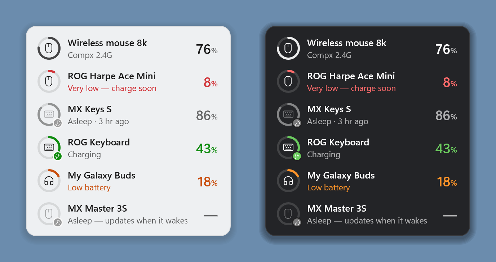

# Device Battery for Windows

A lightweight desktop widget and tray icon that shows, at a glance, the battery of your wireless
mice, keyboards and headphones — including 2.4 GHz receivers Windows cannot read on its own.

This is the Windows version. The macOS version lives in a separate repository,
[DeviceBattery](https://github.com/lizhuoh9/DeviceBattery).



<sub>Light and dark appearance, with sample devices.</sub>

## Features

- **Reads batteries Windows can't**: talks directly to Logitech Bolt / Unifying receivers, the ROG
  Omni receiver and Compx-chip 4K/8K mouse dongles.
- **Bluetooth devices too**: anything Windows reports a battery for — earbuds, mice, keyboards.
  A device that is paired but not connected stays in the list as **Asleep**, with the last level
  Windows kept for it.
- **Knows the level even when a device sleeps**: shows the last level read and when, e.g.
  "Asleep · 3 hr ago".
- **Low battery alerts**: one notification at 20% and another at 10%.
- **Unobtrusive**: sits behind your windows, no taskbar button, no focus stealing. Click the tray
  icon to show or hide it.
- **Speaks your language**: English, 한국어 and 简体中文, following the Windows display language.
- **One small file**: a single `DeviceBattery.exe` of about 550 KB. No installer and no runtime to
  install — the C runtime is linked in statically.

The widget only sends read-only "battery status" queries and never changes any device setting.

## Install

1. Download `DeviceBattery.exe` from [Releases](../../releases) and keep it in a folder of your
   choice (e.g. Documents).
2. Double-click it. The exe is not code-signed, so SmartScreen may say "Windows protected your
   PC": click **More info → Run anyway** (first time only).
3. The widget appears in the top-right corner, plus an icon in the notification area. Right-click
   either one for the menu, and turn on **Start with Windows** there.

There are no permission prompts: Windows lets the widget read the receivers directly.

## Build it yourself

Requires [Rust](https://rustup.rs) and the MSVC build tools (Visual Studio Build Tools with the
"Desktop development with C++" workload); rustup offers to install those for you. Then, in this
folder:

```bash
cargo build --release
```

The exe ends up in `target\release\DeviceBattery.exe`. `windows\.cargo\config.toml` links the C
runtime statically, so build from this folder (the config is found by the working directory).

## Everyday use

| Action | What it does |
| --- | --- |
| Drag the widget | Moves it; the position is remembered |
| Click the widget | Refreshes all batteries now |
| Right-click the widget | Rename or hide a device, keep above other windows, low battery alerts, start with Windows, quit |
| Click the tray icon | Shows or hides the widget |

Reading the widget:

- The **ring** shows the level. Neutral when healthy, orange at 20% or less, red at 10% or less,
  green while charging.
- The **small badge** on the ring: ⚡ charging, 🌙 asleep (the level shown is the last one read).
- The widget refreshes every minute while visible and every 5 minutes while covered by windows.
  Plugging in a receiver and waking the PC trigger an immediate refresh.

## Development

```bash
cargo test                                                          # unit tests
cargo build --release                                               # the exe
target/release/DeviceBattery.exe --render-preview out.png --language en   # preview with sample devices (en / ko / zh-Hans)
target/release/DeviceBattery.exe --list-devices report.txt          # device report for issues
```

```
src/common/   protocol and state logic (pure Rust, unit-tested)
              Logitech HID++, ROG Omni, Compx, Bluetooth parsing, reading store, alerts,
              English / Korean / Chinese text
src/win/      Windows integration: SetupAPI + overlapped HID I/O, Bluetooth device properties,
              Direct2D / DirectWrite rendering, tray menu, rename dialog, settings
assets/       icon and application manifest
```

Missing a device? Run `--list-devices report.txt` (or right-click → **Device Report…**) and attach
the text file to an issue.

## Acknowledgements

Protocol details were learned from these open-source projects (no code was copied):

- Logitech HID++: [Solaar](https://github.com/pwr-Solaar/Solaar)
- ROG: [G-Helper](https://github.com/seerge/g-helper), [rogctl](https://github.com/Humblemonk/rogctl), [battery-tray](https://github.com/mikgangal/battery-tray)
- Compx: [mouse-battery-reminder](https://github.com/245582001g-oss/mouse-battery-reminder)

## License

[MIT](LICENSE) © 2026 Zhuoheng Li
